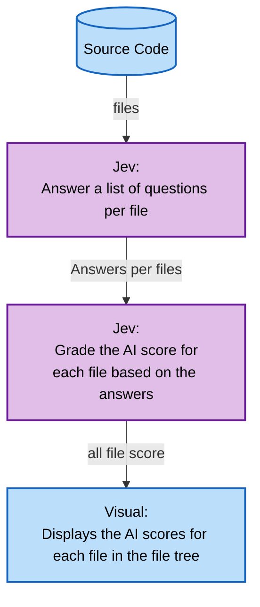

# VibeScan

VibeScan analyzes source code to estimate whether it was written by a human or generated with the help of AI. It supports Python (`.py`), C (`.c`) and Rust (`.rs`) files and generates an HTML report.

## How does it work?
VibeScan uses **Jev**, an artificial intelligence developed by [TypeSafe](https://typesafe.ai/), to thoroughly analyze syntactic structure, naming conventions, comments, and code patterns.
Jev detects phrasing patterns, regularity, and typical turns of phrase in generative models compared to human writing styles.
Thanks to the optimized performance of the Jev engines, the analysis is completed in just a few seconds, even on large-scale projects, ensuring maximum fluidity in your workflows.

## Demonstration

Here are the results of running the scan on the project, including An “example” folder containing samples with code generated by AI to demonstrate the detection's performance:

https://matisse-dev.me/VibeScanDemo

## Workflow




## Installation

Clone the repository and install the dependencies using [uv](https://docs.astral.sh/uv/):

```bash
git clone https://github.com/Arcanovax/VibeScan.git
cd VibeScan
uv sync
```

Create a `.env` file in the project root directory and add your **TypeSafe** API key:

```env
KEY=your_api_key
```

## Usage

Scan the current directory:

```bash
uv run python -m srcs
```

Scan a specific directory:

```bash
uv run python -m srcs --code /path/to/project
```

## Disclaimer

**VibeScan is not 100% accurate.** Its results are estimates and may produce false positives or false negatives. Human-written code can be classified as AI-generated, and AI-generated code can be classified as human-written.

Results should not be considered definitive proof of code authorship.
